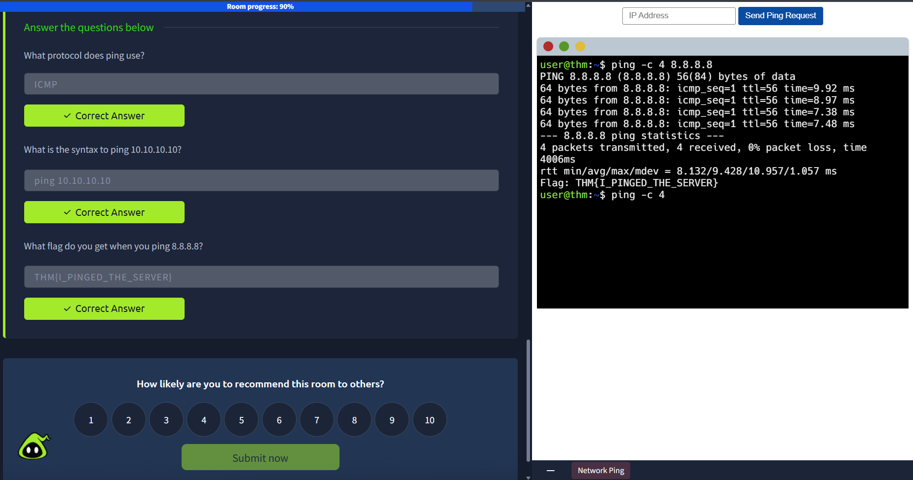

# ICMP Ping Diagnostics — TryHackMe Lab

A practical cybersecurity networking lab focused on ICMP, Ping, and packet analysis using Wireshark.

## About This Project

This project documents a hands-on networking exercise completed in the TryHackMe learning environment.

## Skills Practiced

- Understanding ICMP and Echo Request / Echo Reply.
- Using Linux Ping for network diagnostics.
- Interpreting packet loss, RTT, and TTL.
- Analyzing ICMP traffic using Wireshark.
- Understanding basic network security concepts.

## Lab Information

| Item | Details |
|---|---|
| Platform | TryHackMe |
| Room | What is Networking? |
| Task | Ping (ICMP) |
| Target | 8.8.8.8 |
| Tool | Wireshark |
| Status | Completed |

## Project Files

- [Detailed Documentation](icmp-ping-thm-lab/README.md)
- [Technical Report](icmp-ping-thm-lab/REPORT.md)
- [Evidence Screenshots](icmp-ping-thm-lab/evidence/)
- [Ping Command Output](icmp-ping-thm-lab/logs/ping-output.txt)

## Practical Evidence

## Security Disclaimer

All practical activities documented here were performed in an authorized learning environment. No unauthorized third-party systems were tested.
