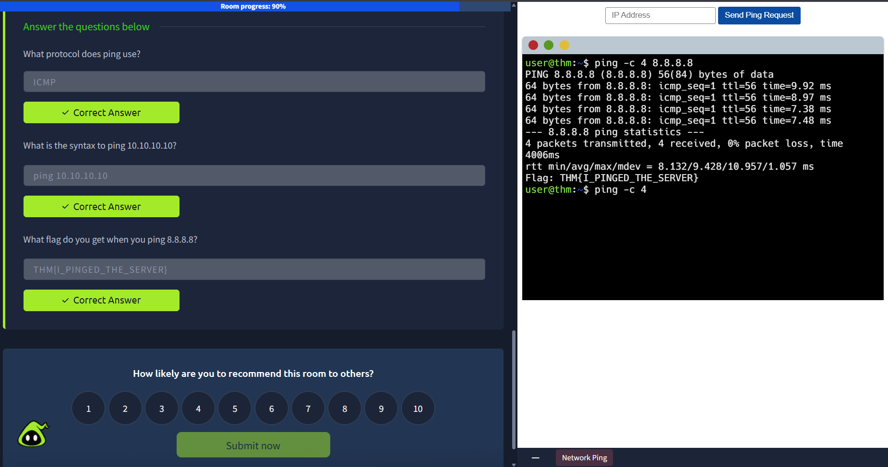
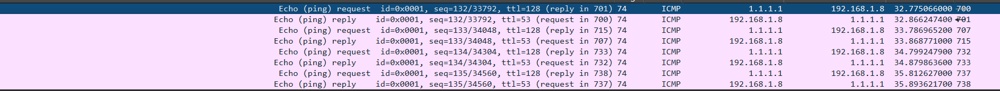
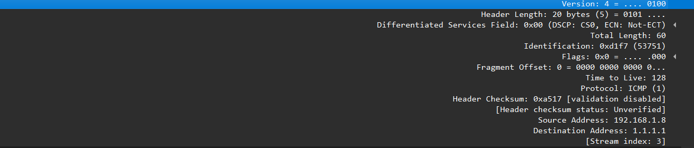
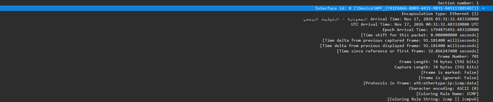

# ICMP Ping Diagnostics — TryHackMe Lab

A small, practical networking exercise focused on **ICMP**, the `ping` utility, and interpreting basic connectivity results. The exercise was completed in the TryHackMe learning environment.

> **Scope:** This documentation describes activity performed in the assigned TryHackMe environment. Do not run tests against systems unless you own them or have explicit authorization.

## Learning objectives

- Explain what ICMP is and why `ping` uses it.
- Distinguish an ICMP Echo Request from an Echo Reply.
- Run a limited number of ICMP probes from Linux.
- Interpret packet counts, packet loss, response time, and the received TTL.
- Relate command-line results to packet fields visible in Wireshark.

## Lab details

| Item | Value |
|---|---|
| Platform | TryHackMe |
| Room | What is Networking? |
| Section | Ping (ICMP) |
| Target used in the exercise | `8.8.8.8` |
| Operating environment | Linux terminal provided by the lab |
| Command | `ping -c 4 8.8.8.8` |
| Status | Completed; the task returned a flag |

## Command explained

```bash
ping -c 4 8.8.8.8
```

- `ping` sends ICMP Echo Requests and reports received Echo Replies.
- `-c 4` tells the Linux `ping` utility to stop after sending four requests.
- `8.8.8.8` is the destination IP address used by this exercise.

For comparison, the equivalent count option on Windows is `-n`:

```powershell
ping -n 4 8.8.8.8
```

## Results recorded from the lab

| Measurement | Recorded result |
|---|---:|
| Packets transmitted | 4 |
| Packets received | 4 |
| Packet loss | 0% |
| Average RTT reported by the terminal summary | 9.428 ms |
| TTL shown on the reply lines | 56 |

**Interpretation:** The supplied terminal summary reports that all four probes received replies, with no packet loss during this short test. The reported average round-trip time was 9.428 ms. This is evidence of ICMP reachability at the time of the test; it does not prove that every application service on the destination is available.

### Output consistency note

The terminal output copied into the lab notes contains two inconsistencies that should be checked against the original terminal or a fresh run before using the exact timing values as portfolio evidence:

1. All four displayed reply lines show `icmp_seq=1`; sequence numbers would normally increment across successive replies.
2. The individual displayed response times (`9.92`, `8.97`, `7.38`, and `7.48` ms) do not agree with the summary line (`min/avg/max/mdev = 8.132/9.428/10.957/1.057 ms`).

The packet counts and flag are recorded as provided, but the timing and sequence details are explicitly marked for verification rather than silently corrected.

## Protocol notes

- `ping` commonly uses ICMP Echo Request and Echo Reply messages.
- In **ICMPv4**, Echo Request is **Type 8, Code 0**; Echo Reply is **Type 0, Code 0**.
- In an IPv4 header, ICMP is identified by **Protocol number 1**.
- ICMP does not use TCP or UDP port numbers.
- The reported RTT is the elapsed time for a request/reply exchange, not a one-way delay.
- The received `TTL` is the value observed in the returning IP packet. It is not, by itself, a reliable way to identify the sender or determine the exact path length because the initial TTL is not known.

## Wireshark analysis checklist

Use a capture from your own device or the authorized lab environment. Start a capture on the relevant interface, run the ping, and apply these display filters:

```text
icmp
icmp.type == 8
icmp.type == 0
```

Inspect the following fields:

- IPv4 source and destination addresses.
- Ethernet source and destination MAC addresses on the captured local link.
- ICMP Type and Code.
- ICMP Identifier and Sequence Number, when displayed.
- IPv4 TTL and the packet timestamps.

**Layer reminder:** Ethernet frames are used on an individual local link; IP packets carry the routed Layer 3 information; ICMP is carried inside IP. When traffic crosses a router, the Layer 2 frame is rebuilt for the next link. Do not confuse a remote host's MAC address with the local default gateway's MAC address.

## Security perspective

### Red Team context

In an authorized assessment, ICMP can help determine whether a permitted target responds to basic reachability probes. A missing reply does not prove that a host is offline: a firewall, filtering policy, routing issue, or rate limit may suppress ICMP.

### Blue Team context

Defenders can baseline expected ICMP activity and investigate unusual volume, unexpected sources, or patterns that differ from normal monitoring. Correlate packet evidence with asset inventory, DHCP/IPAM, firewall logs, and other telemetry before attributing activity to a person or declaring an incident.

An IP address alone does not establish the identity of the person using it. Geolocation or provider information is contextual evidence, not proof of attribution.

## Evidence

The screenshots below document the practical work completed in the TryHackMe lab and the related Wireshark packet analysis. Keep all four image files inside the [`evidence/`](evidence/) directory.

### 1. TryHackMe lab result

This screenshot shows the TryHackMe terminal output after running the ping command and retrieving the task completion flag.



### 2. Wireshark capture

This screenshot documents the ICMP traffic observed in Wireshark.



### 3. Wireshark packet analysis — view 1

This screenshot provides an additional view of the captured ICMP packets and their fields.



### 4. Wireshark packet analysis — view 2

This screenshot provides a second packet-detail view for comparison of the ICMP request and reply.



> **Privacy note:** Before publishing, check that the screenshots do not expose personal email addresses, account details, session tokens, or unrelated private network information. The descriptions above assume the image files use the `.png` extension; update the links if your actual files use `.jpg` or `.jpeg`.

## Flag handling

The completion flag is stored locally in `private/flag.txt`. The `private/` directory is excluded by `.gitignore` so the flag is not accidentally published in a public repository. The README records that a flag was obtained without exposing its value.

## Suggested repository contents

```text
icmp-ping-thm-lab/
├── README.md
├── REPORT.md
├── .gitignore
├── evidence/
│   └── README.md
├── logs/
│   └── ping-output.txt
└── private/
    └── flag.txt   # ignored by Git; keep local
```

## Completion

- [x] Read the ICMP and Ping explanation.
- [x] Run `ping -c 4 8.8.8.8` in the assigned lab environment.
- [x] Obtain the task completion flag.
- [x] Add the TryHackMe screenshot (`tryHackme_lab`).
- [x] Add the Wireshark screenshots (`wireshark`, `wireshark_1`, and `wireshark_2`).
- [x] Commit and push the sanitized project to GitHub.
